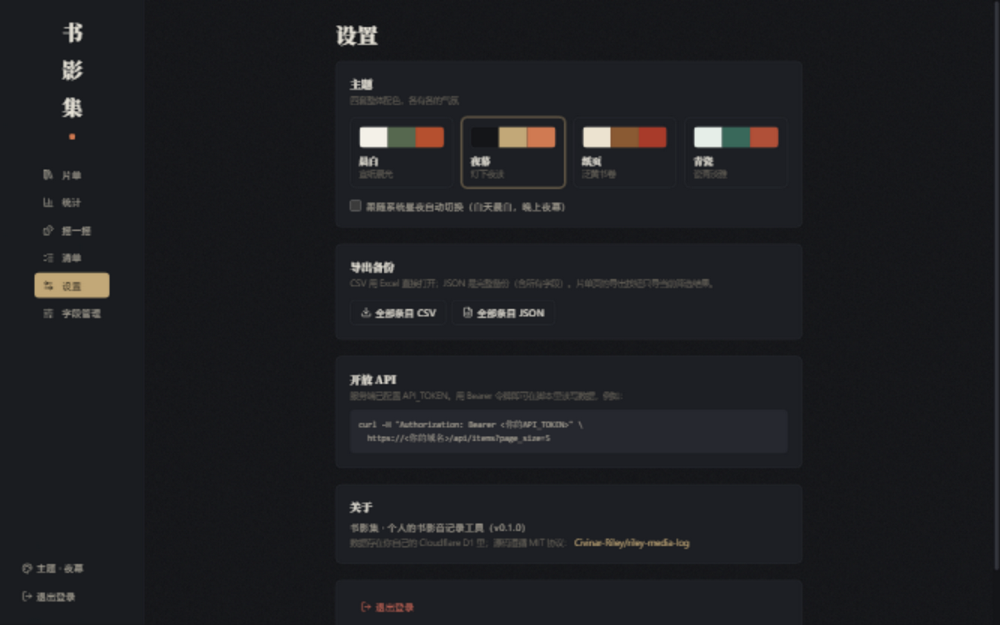

<div align="center">

# 书影集 · riley-media-log

**个人的书影音记录工具：电影、剧集、动漫、综艺、小说、漫画，看过的和想看的都记在这里。**

跑在 Cloudflare Workers + D1 上，免费套餐即可长期运行，数据完全属于你自己。

[](./LICENSE)
[](./package.json)
[](https://developers.cloudflare.com/workers/)
[](https://developers.cloudflare.com/d1/)
[](https://react.dev)
[](#-功能特性)

[项目简介](#-项目简介) · [界面预览](#-界面预览) · [功能特性](#-功能特性) · [安装](#-安装) · [使用指南](#-使用指南) · [开放接口](#-开放接口) · [仓库结构](#-仓库结构) · [常见问题](#-常见问题) · [版本历史](#-版本历史) · [声明与授权](#-声明与授权) · [致谢](#-致谢)

</div>

---

## 📖 项目简介

书影集是一个自托管的个人书影音记录工具，起源于「把多年零散的追片记录整理明白」这个朴素需求。

- **自己填**：标题、年份、地区、类型标签、主创、状态、进度、评分、封面、备注、观后感，全部手动可控，不依赖任何外部数据源；
- **随便筛**：十一个维度任意组合筛选，多选字段支持「任一匹配 / 同时命中全部」两种模式；
- **放心里**：数据存在你自己的 Cloudflare D1 里，界面有密码锁，仓库与截图不含任何个人条目数据；
- **零成本**：Workers 免费额度对个人用量绰绰有余，无需服务器；
- **从 Excel 无缝迁移**：自带导入脚本，查重、拼音索引一条龙。

技术栈：Hono（Workers API）+ React 19 + Vite + Tailwind CSS 4 + Cloudflare D1，单 Worker 同时服务 API 与前端页面。

## 📷 界面预览

| 片单 · 类别页签（晨白） | 统计面板（晨白） |
| :---: | :---: |
|  |  |

| 设置 · 类别与人名管理（夜幕） | 手机端（PWA） |
| :---: | :---: |
|  |  |

*界面截图使用本地演示数据（`python scripts/seed_demo.py` 生成），非真实记录。*

## ✨ 功能特性

### 入口一 · 记录与浏览

| 特性 | 说明 |
| :--- | :--- |
| 🎬 六大类别 | 电影 / 剧集 / 动漫 / 综艺 / 小说 / 漫画，小说与漫画各有「完结状态」字段 |
| 🏷 四种状态 | 想看 / 在看 / 看过 / 弃了，另附自由文本进度（如「看到第 8 集」） |
| 🌏 多值字段 | 地区、类型标签、作者 / 导演 / 主演均为多选，输入时自动补全历史值；每个类别可配置显示哪些人员字段 |
| 🪪 人名别名 | 外国导演/主演的英文原名与中文译名可登记「别名 → 主名」，填写自动归一，历史数据一键统一 |
| 🔁 观看流水 | 每次观看一条记录（日期 + 一句话短评），二刷直接追加 |
| 🕘 条目动态 | 添加、改状态、改评分、记流水全部自动记入时间线 |
| 📋 个人清单 | 自由建单，从片单里搜索勾选加入，可整体维护 |

### 入口二 · 筛选与统计

| 特性 | 说明 |
| :--- | :--- |
| 🗂 类别页签 | 顶部按类别切换（带条目计数），下方状态快捷条一键筛「想看 / 在看 / 看过 / 弃了」，计数随页签联动 |
| 🔍 十一维筛选 | 类别、状态、年份区间、地区、标签、主创、评分下限、观看日期区间、有无封面、有无观后感、标题/拼音搜索 |
| 🔀 匹配模式 | 地区 / 标签 / 主创多选时可切换「任一匹配」或「全部匹配（AND）」 |
| 📊 统计面板 | 总量、看过、想看、今年看完四张数字卡；年度观看量、想看积压、类别分布、评分分布、地区 / 标签 / 主创 TOP 榜，点图表直接下钻 |
| 🎲 随机推荐 | 从想看里摇一个「今晚看什么」，可一键标记看完 |
| ✂️ 字段管理 | 标签 / 地区 / 主创 / 渠道支持改名与合并，全局生效 |

### 入口三 · 体验

| 特性 | 说明 |
| :--- | :--- |
| 🧱 双视图 | 封面网格或紧凑表格，选择会被记住 |
| 🎨 四套主题 | 晨白 / 夜幕 / 纸页 / 青瓷，可跟随系统昼夜自动切换 |
| 📱 手机适配 | 响应式布局 + PWA，手机上加到主屏幕随手记 |
| 🔐 修改密码 | 设置页内直接修改登录密码；Cloudflare 应急密钥作为忘记密码时的找回通道 |
| 📤 导出备份 | CSV（Excel 直接打开）与 JSON 完整备份，支持导出当前筛选结果或全部 |
| 🔤 拼音搜索 | 标题支持全拼检索（如输入 `manchang` 找到《漫长的季节》），列表按拼音首字母排序 |

## 📦 安装

**环境要求**

- Node.js 20+ 与 npm（开发部署）
- Python 3（仅 Excel 导入需要，依赖 `openpyxl` 与 `pypinyin`）
- 一个 Cloudflare 账号（免费套餐即可，仅部署需要）

**安装步骤**

1. **克隆并安装依赖**：`git clone https://github.com/Civinar-Riley/riley-media-log.git && cd riley-media-log && npm install`
2. **配置本地密钥**：在项目根目录创建 `.dev.vars`（已被 gitignore），内容见下方配置一览；
3. **初始化本地数据库**：`npm run db:migrate:local`；
4. **启动**：`npm run dev`，打开 `http://localhost:5173`，输入 `AUTH_PASSWORD` 登录即用。

**配置一览**

| 项 | 位置 | 说明 |
| :--- | :--- | :--- |
| `AUTH_PASSWORD` | `.dev.vars` / `wrangler secret` | 登录密码 |
| `SESSION_SECRET` | `.dev.vars` / `wrangler secret` | 签名登录 cookie 的随机长字符串 |
| `API_TOKEN` | `.dev.vars` / `wrangler secret` | 脚本调用 API 用的 Bearer 令牌 |
| `database_id` | `wrangler.jsonc` | 部署前替换为 `wrangler d1 create` 返回的真实 ID |

> ⚠️ **所有密钥只进 `.dev.vars` 或 `wrangler secret`**：`.dev.vars`、`*.xlsm`、`data/` 均已 gitignore，切勿把密码或个人数据提交进仓库。
> ⚠️ **`wrangler.jsonc` 里的 `database_id` 是占位符**：首次部署前必须替换成 `wrangler d1 create` 返回的真实值。
> ⚠️ **验证安装成功**：本地能登录并看到片单页（空列表或导入后的数据）即为成功。

## 🚀 使用指南

| 场景 | 操作 |
| :--- | :--- |
| **导入 Excel 存量记录** | `python scripts/import_excel.py --input 你的表.xlsx` 生成 `data/import.sql` 与对账报告 → `npx wrangler d1 execute riley-media-log --local --file data/import.sql`（线上库加 `--remote`）。脚本按表头关键词识别列、按「动漫/电影/剧集/综艺/小说」工作表读取（你的表头用词不同时，调整脚本里 detect_columns 的关键词即可）：进度「已阅」→看过、数字→在看+进度、小说表「类型=漫画」自动归入漫画、作者进作者字段、状态进完结状态；按「标题+年份+类别」查重打标 |
| **日常记一笔** | 右上角「记一笔」→ 填个标题就能保存，其余字段随时补 |
| **补记多年前的老片** | 记一笔 → 状态选「看过」→ 填年份 → 观后感写两句 → 顺手打个星 |
| **记二刷** | 打开条目详情 → 观看流水里选日期、写一句感受 → 「记一次观看」 |
| **建一张主题清单** | 清单页新建（如「2026 补片计划」）→ 进清单「添加条目」→ 搜索勾选加入 |
| **选择困难时** | 侧边栏「摇一摇」→ 从想看里随机摇一个，看完直接点「看完了」 |
| **找某段时间看的东西** | 片单页「筛选」→ 观看日期区间 → 图表下钻也能到同样效果 |
| **标签乱了** | 字段管理 → 选中值改名；改成已存在的名字即为合并，全局生效 |
| **备份到 Excel** | 片单页右上角下载图标导出当前筛选，设置页导出全部 CSV/JSON |
| **脚本批量读写** | 用 `API_TOKEN` 走 Bearer 调 `/api/*`，见下方开放接口 |
| **手机上用** | 浏览器打开站点 → 添加到主屏幕（PWA），底部标签栏切换页面 |
| **修改登录密码** | 设置页 → 登录密码 → 输入当前密码和新密码即可；改后立即生效，已登录设备不受影响 |

## 🔌 开放接口

所有 `/api/*` 路由既接受登录 cookie，也接受 `Authorization: Bearer <API_TOKEN>` 令牌，方便脚本批量读写：

| 方法与路径 | 说明 |
| :--- | :--- |
| `GET /api/items` | 条目列表，支持全部筛选参数（`q`、`category`、`status`、`tags`、`tag_mode=any/all`、`authors`、`actors`、`year_min` 等）与 `sort` / `order` / `page` 分页 |
| `POST /api/items` | 新建条目（JSON） |
| `GET /api/items/:id` | 条目详情（含观看流水、所在清单、动态） |
| `PUT /api/items/:id` | 局部更新条目 |
| `DELETE /api/items/:id` | 删除条目 |
| `GET /api/items/random` | 随机抽一条，可带筛选条件 |
| `POST /api/items/:id/viewings` | 追加观看流水 |
| `GET /api/lists` · `POST /api/lists` | 清单列表 / 新建清单 |
| `GET /api/stats` | 统计面板全部数据（含作者 / 导演 / 主演 TOP） |
| `GET /api/settings` · `PUT /api/settings/categories` | 类别定义读取与整体保存 |
| `PUT /api/settings/aliases` · `POST /api/settings/aliases/normalize` | 人名别名映射保存 / 历史数据一键归一 |
| `GET /api/export.csv` · `GET /api/export.json` | 导出（可带筛选参数，只导出筛选结果） |
| `GET /api/fields/values?field=tags` | 枚举某字段全部取值与计数 |
| `POST /api/fields/rename?field=tags` | 字段值改名 / 合并（body: `{"from":[...],"to":"..."}`） |

示例：

```bash
curl -H "Authorization: Bearer <你的API_TOKEN>" "https://<你的域名>/api/items?status=want&page_size=5"
```

## 📁 仓库结构

```text
├── migrations/            # D1 表结构迁移
├── scripts/
│   ├── import_excel.py    # Excel → SQL 导入脚本（Python，--input 指定文件）
│   ├── seed_demo.py       # 演示数据种子（虚构片名，供截图或体验）
│   └── qa_sweep.py        # API 回归测试（以当前库为基准，任意数据集可跑）
├── public/                # PWA manifest、图标、Service Worker
├── docs/screenshots/      # README 截图（演示数据）
├── src/
│   ├── shared/            # 前后端共享：类型、枚举、筛选参数解析
│   ├── worker/            # Hono 后端：认证、条目、清单、字段、统计、导出
│   └── web/               # React 前端：页面、组件、主题系统
├── 防踩坑.md              # 开发与部署中真实踩过的坑与解法
├── wrangler.jsonc         # Cloudflare 配置（Worker + 静态资产 + D1）
└── vite.config.ts
```

## ❓ 常见问题

| 问题 | 回答 |
| :--- | :--- |
| 数据存在哪？会丢吗？ | 在你自己账号的 Cloudflare D1 里；随时可在设置页导出 CSV/JSON 备份 |
| 忘记密码怎么办？ | 应用内改过密码后忘了：`npx wrangler secret put AUTH_PASSWORD` 设置的应急密钥仍可登录（两把钥匙任一有效），登录后可在设置页重新设置密码 |
| 能自动从豆瓣/TMDB 拉信息吗？ | 尚未接入；条目已预留 `tmdb_id` 字段，后续可做自动补全 |
| 为什么要密码？ | 部署后在公网可访问，密码是唯一的门锁；纯本地运行同样需要 |
| 部署要花钱吗？ | Workers 免费额度对单人使用完全够用，D1 免费额度以百万次读计 |
| 多人能用吗？ | 目前单用户设计（一个密码共用）；数据模型不阻止将来加多用户 |
| 遇到奇怪的报错怎么办？ | 先翻 [防踩坑.md](./防踩坑.md)：开发与部署中真实踩过的坑（SQL 拼接、SW 缓存、Windows 编码、部署顺序等）都有现象与解法 |

## 🕘 版本历史

- **v0.1.0（2026-10-11）**：首个可用版本。六大类别记录、四状态 + 进度、评分、观看流水与条目动态、类别自定义与页签、作者 / 导演 / 主演拆分与人名别名归一、十一维筛选（任一 / 全部匹配）、统计面板与图表下钻、随机推荐、个人清单、字段改名合并、CSV/JSON 导出、四套主题、PWA、密码登录 + Bearer 令牌 API、Excel 导入脚本、GitHub Actions 自动部署。详细变更见 [CHANGELOG.md](./CHANGELOG.md)。

## 📜 声明与授权

- 基于 [MIT License](./LICENSE) 开源，可自由使用、修改与分发。
- 本仓库只包含代码与文档；README 截图使用演示数据生成。
- 部署后的站点数据归部署者所有，与作者无关。

## 🙏 致谢

- [Cloudflare Workers](https://developers.cloudflare.com/workers/) 与 [D1](https://developers.cloudflare.com/d1/)：让个人工具零成本长期在线
- [Hono](https://hono.dev)、[React](https://react.dev)、[Tailwind CSS](https://tailwindcss.com)、[Recharts](https://recharts.org)、[pinyin-pro](https://github.com/zh-lx/pinyin-pro)、[pypinyin](https://github.com/mozillazg/python-pinyin)：本项目直接依赖的开源库
- [NeoDB](https://neodb.social)、[Ryot](https://github.com/IgnisDa/ryot)、[Movary](https://github.com/leepeuker/movary) 等开源追踪器：设计过程中反复参考的功能来源
